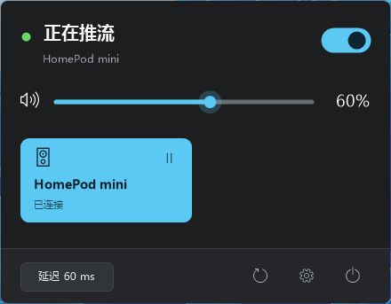

# AirPlay4Windows

**English** · [中文](README.zh-CN.md)

Stream Windows system audio to HomePod and other AirPlay 2 receivers from a compact tray panel.

This is [MotorBottle](https://github.com/MotorBottle)'s UI and user-experience fork of
[AirPlay Bridge by RiverFlowsInUUU](https://github.com/RiverFlowsInUUU/AirPlay-Bridge), based on **v1.5.58**.
The original application and protocol work belong to their respective authors. This fork is not an upstream release.

## Install

- Windows 10 / 11, 64-bit; process loopback requires a supported Windows build.
- Fork packages, when published, appear in [this repository's Releases](https://github.com/MotorBottle/AirPlay4Windows/releases).
- No fork installer has been published yet. Build instructions: [Development](docs/DEVELOPMENT.md).
- Upstream installers do **not** include this fork's panel and interaction changes.
- The executable and installed application still use the name **AirPlay Bridge**.

## What this fork changes

The main focus is **UI and everyday usability**, with supporting audio and latency adjustments.

- A single dark panel with device cards, a streaming switch and a directly draggable volume slider.
- No taskbar button for the panel; drag its header to move it, click outside or press Esc to dismiss it.
- Settings stay accessible without making the panel disappear; matching refresh, settings and power icons.
- Pause, disconnect and exit restore local audio when the app owns the mute state; resume mutes it again.
- Default capture prefers process loopback without installing a virtual cable or switching the default output. Selecting a specific output uses endpoint capture.
- Adjustable requested buffer (1–300 ms), receiver-volume control and a fix for silence falsely disabling local muting.

  

Actual panel rendering in a silent preview with an example device. The screenshot is not a latency measurement.

## Usage

Click the tray icon to open the panel; click again, click elsewhere or press Esc to hide it.

| Control | Action |
|---|---|
| Device card | Connect; click the current device again to disconnect |
| Top switch | Pause and restore local sound; resume and mute the local output |
| Header | Drag to move the panel |
| Volume slider | Change receiver volume immediately; arrow keys fine-tune |
| Latency button | Set the requested buffer and reconnect |
| Refresh | Disconnect, scan and update the device list |
| Settings | Capture source, quality, standby, local mute, startup, language, device visibility, reconnect, diagnostics and logs |
| Power icon | Exit and restore local sound |

## Adjustable

Upstream presets remain available; the panel also provides continuous controls.

| Item | Presets | Range | Applies |
|---|---|---|---|
| Latency | 130 / 150 / **200** / 250 / 300 ms | continuous slider (1–300) | on reconnect |
| Volume | Off / 30% / 50% / 70% / 100% | continuous slider (0–100) | immediately |
| Quality | Fast / Standard / High / Very high / Maximum | continuous slider (0–100) | on reconnect |
| Standby when silent | 5 / 10 / 15 / 20 / 30 / 60 / 120 / 300 s | continuous slider (0–300) | immediately |

Bold marks the default. Standby at 0 turns it off. Buffer settings are **not measured end-to-end latency**.
Lower values can crackle; a setting that works on one machine is not a guarantee for other hardware or networks.

## Current limitations

Device discovery is retained from upstream and is **not currently scheduled for further work in this fork**.
Contributions are welcome through [pull requests](https://github.com/MotorBottle/AirPlay4Windows/pulls), or you can maintain your own fork.

| Area | Current behavior / limitation |
|---|---|
| Discovery | Scans TCP port 7000 on one active adapter's IPv4 /24 subnet, then queries candidates using unicast mDNS. Multiple adapters, other subnets, IPv6-only receivers or other ports may be missed. |
| Remembered device | Startup prefers the last IP. If no receiver ID was saved, identity relies mainly on that address; name alone is not a reliable identity check. |
| Identity mismatch | If the queried ID differs from the remembered ID, the direct-connect path logs a warning but does not reject the target. |
| Automatic selection | A scan prefers the remembered ID, then the only device, then the first HomePod, then the first remaining device. It may select another receiver when the previous one is absent. |
| Refresh | Interrupts streaming to scan; it is not a background-only list refresh. |
| Audio compatibility | Process capture depends on Windows support; endpoint capture may be affected by the sound driver. Silent input alone does not establish mute compatibility. |
| Latency and coverage | Quality/latency changes reconnect. Testing has focused on one Windows PC and a HomePod mini; other combinations are not broadly validated. |
| Updates | The in-app update check still targets upstream releases, not this fork. Follow this repository for fork updates. |

## Troubleshooting

| Symptom | Check |
|---|---|
| No sound | Panel connection state, receiver volume, Windows playback device and Settings → Logs |
| Stuck connecting | Settings → Connection check; allow the app's local-network firewall rule if missing |
| Crackling | Increase the requested buffer; check Wi-Fi stability |

## History and contribution

- [Fork changes and provenance](docs/FORK.md)
- [Complete changelog](CHANGELOG.md), retaining upstream entries
- [Commit history](https://github.com/MotorBottle/AirPlay4Windows/commits/master/), retaining original authors and individual fork commits
- [Development](docs/DEVELOPMENT.md) · [Repository guidance](AGENTS.md)

Please report fork-specific panel and interaction problems here, not to the upstream author.
There is no commitment to implement every request or maintain broad device compatibility.

## Credits and license

- **[RiverFlowsInUUU / AirPlay Bridge](https://github.com/RiverFlowsInUUU/AirPlay-Bridge)** — original Windows application and foundation of this fork.
- **[MotorBottle](https://github.com/MotorBottle)** — this fork's UI, interaction and everyday-use improvements.
- **[Andreas Wendorf / airplay2-sender-cpp](https://github.com/akustikrausch/airplay2-sender-cpp)** — AirPlay protocol engine.
- [Mbed TLS](https://github.com/Mbed-TLS/mbedtls) — cryptography; see the protocol engine's third-party notices for additional credits.
- [VB-Audio Virtual Cable](https://vb-audio.com/Cable/) — optional audio-routing tool referenced by upstream; not required for the preferred capture path here.

[Apache-2.0](LICENSE). Existing copyright and license notices are retained; see [NOTICE](NOTICE).
AirPlay and HomePod are Apple trademarks. This is an independent project, not affiliated with or endorsed by Apple or the upstream authors.
