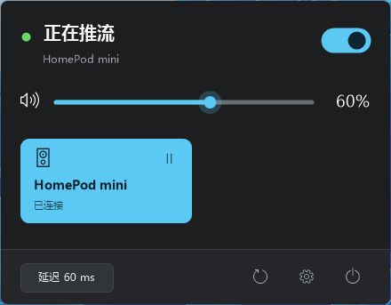

# AirPlay4Windows

[English](README.md) · **中文**

通过简洁的托盘面板，把 Windows 系统声音推流到 HomePod 等 AirPlay 2 接收设备。

这是 [MotorBottle](https://github.com/MotorBottle) 基于
[RiverFlowsInUUU 的 AirPlay Bridge](https://github.com/RiverFlowsInUUU/AirPlay-Bridge) **v1.5.58** 制作的 UI 与使用体验优化分支。
原应用和协议实现的贡献归各自作者所有；本分支不是上游正式版本。

## 安装

- Windows 10 / 11，64 位；进程环回采集需要受支持的 Windows 版本。
- 本分支的安装包发布后会放在[本仓库 Releases](https://github.com/MotorBottle/AirPlay4Windows/releases)。
- 目前尚未发布本分支安装包，编译方法见[开发文档](docs/DEVELOPMENT.md)。
- 上游安装包**不包含**本分支的面板和交互改动。
- 程序文件和已安装应用目前仍使用 **AirPlay Bridge** 名称。

## 本分支做了什么

主要改动是 **UI 和日常使用体验**，同时包含配套的音频与延迟调整。

- 单层深色面板：设备卡片、推流开关和可直接拖动的音量滑条。
- 面板不占任务栏；顶部可拖动，点击外部或按 Esc 自动收起。
- 打开设置时保留面板，统一刷新、设置和电源图标的风格。
- 暂停、断开和退出时，恢复由程序静音的本机输出；继续推流时重新静音。
- 默认优先进程环回采集，无需安装虚拟声卡或切换默认播放设备；指定输出设备时使用端点采集。
- 请求缓冲可调（1–300ms）、接收端音量控制，以及无声时误判静音不兼容的修复。

  

截图来自实际面板代码的无声预览，使用示例设备；不代表实际出声延迟测量。

## 使用

单击托盘图标打开面板；再次单击、点击外部或按 Esc 收起。

| 操作 | 行为 |
|---|---|
| 设备卡片 | 连接；再次点击当前设备则断开 |
| 右上角开关 | 暂停并恢复本机声音；继续时静音本机 |
| 顶部空白处 | 拖动面板 |
| 音量滑条 | 立即调整接收端音量；方向键微调 |
| 延迟按钮 | 调整请求缓冲并重连 |
| 刷新图标 | 断开推流、扫描并更新设备列表 |
| 设置图标 | 采集来源、音质、待机、本机静音、自启、语言、设备显示、重连、诊断和日志 |
| 电源图标 | 退出并恢复本机声音 |

## 可调项

保留上游配置档位，面板另提供连续控制。

| 项 | 档位 | 无极滑块 | 生效 |
|---|---|---|---|
| 延迟 | 130 / 150 / **200** / 250 / 300 ms | 1–300 | 重连后 |
| 音量 | 关 / 30% / 50% / 70% / 100% | 0–100 | 立即 |
| 音质 | 快速 / 标准 / 高 / 极高 / 至臻 | 0–100 | 重连后 |
| 无声音时待机 | 5 / 10 / 15 / 20 / 30 / 60 / 120 / 300 秒 | 0–300 | 立即 |

粗体为默认值，待机设为 0 即关闭。缓冲设置**不等于实测端到端延迟**。
数值过低可能爆音；某台电脑可用的设置，不保证适用于其他硬件和网络。

## 当前不足

设备发现沿用上游实现，**本分支暂不计划继续完善这部分**。
有需要可以提交 [PR](https://github.com/MotorBottle/AirPlay4Windows/pulls)，或自行 fork 后维护。

| 方面 | 当前行为与限制 |
|---|---|
| 设备发现 | 扫描一块活动网卡的 IPv4 /24 网段中 TCP 7000 端口，再单播查询 mDNS；多网卡、跨网段、仅 IPv6 或其他端口的设备可能漏掉。 |
| 记住设备 | 启动优先连接上次 IP；没有保存接收端 ID 时主要依赖地址，名称不作为可靠身份校验。 |
| 身份不一致 | 直连时查询到的 ID 与历史记录不同，目前只记日志，不会拒绝目标。 |
| 自动选择 | 扫描后优先历史 ID，再选唯一设备、第一台 HomePod、最后第一台其他设备；原设备不在时可能选中其他接收端。 |
| 刷新列表 | 会先中断推流再扫描，不是纯后台刷新。 |
| 音频兼容性 | 进程采集依赖 Windows 支持，端点采集可能受声卡驱动影响；仅凭无声不能判断静音兼容性。 |
| 延迟与验证范围 | 音质和延迟修改需要重连；主要在一台 Windows 电脑和 HomePod mini 上验证，未广泛覆盖其他组合。 |
| 更新检查 | 程序内的更新检查仍指向上游版本，不是本分支；本分支更新请关注本仓库。 |

## 排障

| 现象 | 检查项 |
|---|---|
| 没声音 | 面板连接状态、接收端音量、Windows 播放设备，以及设置 → 日志 |
| 一直连接中 | 设置 → 连接诊断；缺少本地网络防火墙规则时按提示放行 |
| 爆音 | 增大请求缓冲，检查 Wi-Fi 稳定性 |

## 历史与贡献

- [分支改动与来源](docs/FORK.md)
- [完整变更记录](CHANGELOG.md)，保留上游历史条目
- [Git 提交历史](https://github.com/MotorBottle/AirPlay4Windows/commits/master/)，保留原作者及本分支各次提交
- [开发文档](docs/DEVELOPMENT.md) · [仓库协作规范](AGENTS.md)

本分支特有的面板和交互问题请在这里反馈，不要要求原作者为这些改动提供支持。
本分支不承诺实现所有需求或持续维护广泛的设备兼容性。

## 致谢与许可证

- **[RiverFlowsInUUU / AirPlay Bridge](https://github.com/RiverFlowsInUUU/AirPlay-Bridge)**：原 Windows 应用，本分支的基础。
- **[MotorBottle](https://github.com/MotorBottle)**：本分支的 UI、交互与日常体验优化。
- **[Andreas Wendorf / airplay2-sender-cpp](https://github.com/akustikrausch/airplay2-sender-cpp)**：AirPlay 协议引擎。
- [Mbed TLS](https://github.com/Mbed-TLS/mbedtls)：加密；其他依赖贡献见协议引擎内的第三方声明。
- [VB-Audio Virtual Cable](https://vb-audio.com/Cable/)：上游提及的可选音频路由工具，本分支默认采集路径无需安装。

[Apache-2.0](LICENSE)。保留已有版权和许可声明，详见 [NOTICE](NOTICE)。
AirPlay 和 HomePod 为 Apple 商标。本项目独立开发，不代表 Apple 或上游作者，也未获其背书。
